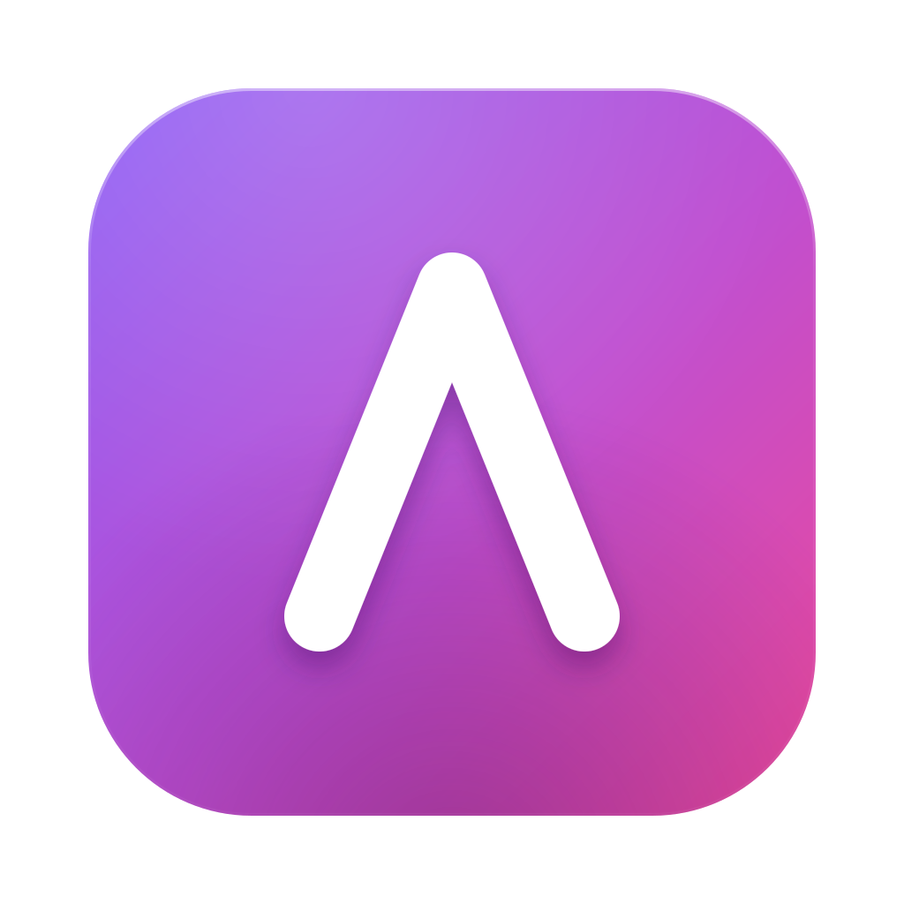
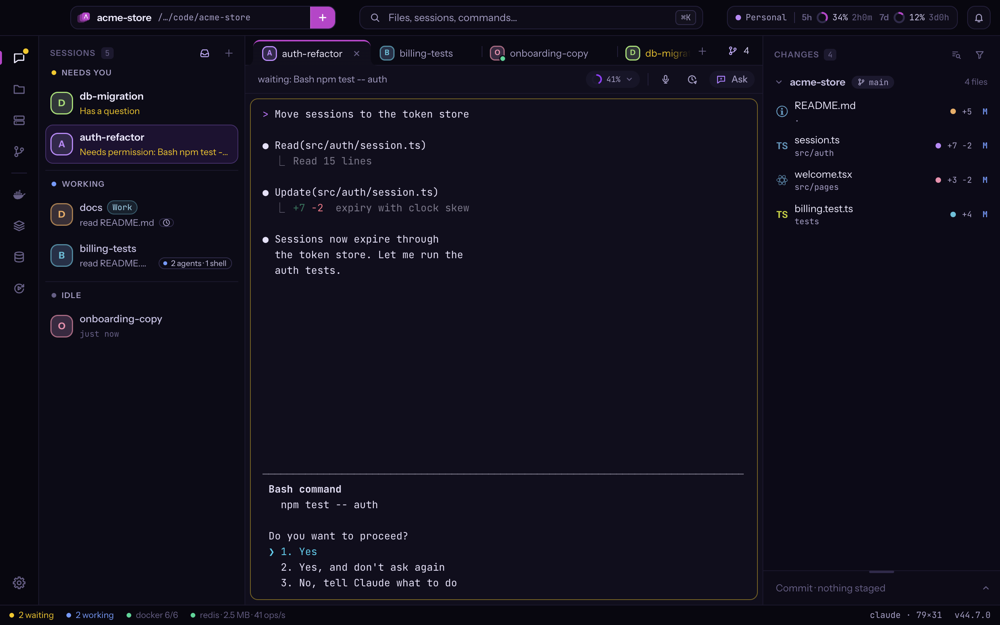

<div align="center">



# Atelier

**Run many Claude Code sessions side by side, and always know which one needs you.**

A desktop app for macOS and Windows built around the real `claude` CLI: live session states, every change traced to
the session that made it, and an editor, terminals and Git right beside them.

[Website](https://useatelier.dev) · [Download](https://useatelier.dev/download) ·
[Releases](https://github.com/atelieride/atelier/releases) ·
[Try it in your browser](https://useatelier.dev/demo) · [Changelog](CHANGELOG.md) ·
[♥ Support Atelier](https://useatelier.dev/support)


[](LICENSE)

</div>



## Features

- **Know who needs you.** Every session shows whether it is working, waiting for permission, asking something, done or
  failed. <kbd>⌘J</kbd> jumps to the next one that needs you.
- **The real Claude Code.** `claude` runs in real terminals with its own commands, status line and updates. Use several
  Claude accounts and pick one per session, with its limits in view.
- **Sessions outlive the app.** A background service (`atelierd`) owns the terminals: quit, update or restart Atelier
  and your sessions keep going.
- **See who changed what.** Changed files carry the colour of the session that touched them. Review with line comments
  sent back to Claude, then commit and push from the same panel.
- **Catch up without interrupting.** Ask a session where it is and why, in a read-only side chat that leaves its
  context untouched.
- **Everything side by side.** Sessions, terminals and files are tabs: split up to three panes, open anything from the
  command palette, keep separate lines of work in workspaces.
- **Prompts and tasks that start themselves.** Schedule a prompt for later, for instance when your usage limit resets,
  or let ClickUp, Notion and Jira tasks start sessions in worktrees of their own.
- **Your stack next to Claude.** Read your Docker logs, browse Redis keys and queues and Postgres tables, and send what
  matters to a session in one click.
- **Dictation.** Turn it on, hold <kbd>⌥ Space</kbd> and speak: transcription runs on your computer with whisper.cpp.

## Install

You need [Claude Code](https://docs.anthropic.com/en/docs/claude-code) installed and signed in (`claude` works in a
terminal).

- **macOS 13 or later, Apple Silicon:** download the DMG from [useatelier.dev/download](https://useatelier.dev/download)
  and drag Atelier to Applications. It is signed and notarized, and it updates itself (choose Stable or Beta in
  Settings › About).
- **Windows 10 (2004 or later) or 11, 64-bit:** install it from the
  [Microsoft Store](https://apps.microsoft.com/detail/9N9FX0BQ20HF), which keeps it up to date. Install
  [Git for Windows](https://git-scm.com/download/win) for changes, branches and history.

## Getting started

1. Open a project folder: **File › Open Folder…** (<kbd>⌘O</kbd>).
2. Press <kbd>⌘N</kbd> to start a Claude session. Start as many as you like: the sidebar groups them by state.
3. Work with the rest while they run, and press <kbd>⌘J</kbd> when one needs you.

| Keys | |
|---|---|
| <kbd>⌘N</kbd> | New Claude session |
| <kbd>⌘J</kbd> | Next session that needs you |
| <kbd>⌘K</kbd> | Command palette: files, sessions, commands |
| <kbd>⌘\\</kbd> | Split view |
| <kbd>⇧⌘N</kbd> | Resume a session |
| <kbd>⌘L</kbd> | Mention the selected lines in the session |

On Windows a terminal keeps <kbd>Ctrl</kbd> + letter for its program, so most of these become <kbd>Ctrl</kbd>
<kbd>Shift</kbd> + letter (<kbd>⌘N</kbd> is <kbd>Ctrl</kbd> <kbd>Shift</kbd> <kbd>N</kbd>). Settings › Keyboard lists
every shortcut.

## Build from source

You need Node.js 22 (see `.nvmrc`) and, for the native helpers, the Xcode Command Line Tools on macOS or the Visual
Studio Build Tools (C++) on Windows. On macOS the tests also need tmux (`brew install tmux`).

```sh
npm ci
npm run dev             # the app with hot reload
npm test                # unit and integration tests
npm run typecheck
npm run e2e             # end-to-end tests (Playwright driving the Electron app)
npm run build:whisper   # whisper.cpp for on-device dictation (optional for dev runs)
npm run dist:unsigned   # a packaged, unsigned app in release/ (builds whisper.cpp too)
```

Set `ATELIER_HOME` to an empty folder to keep a development instance apart from an installed Atelier: its settings,
its background service and its sessions.

| Folder | What it holds |
|---|---|
| `src/main` | Electron main process: windows, IPC, Git, settings, updates |
| `src/daemon` | `atelierd`, the background service that owns the terminals |
| `src/renderer` | The interface: React, xterm.js terminals, CodeMirror editor |
| `src/preload` | The only bridge between the interface and the main process |
| `src/shared` | Pure logic shared by all of the above |
| `native` | Small native helpers (terminal host, dictation, Windows bridges) |
| `site` | The website, [useatelier.dev](https://useatelier.dev) |
| `src/demo` | The in-browser demo the website runs |

## Contributing

Issues are welcome: bugs, ideas and questions alike. For a pull request, please open an issue first so we can agree
on the change; [CONTRIBUTING.md](CONTRIBUTING.md) has the rest, and [CLAUDE.md](CLAUDE.md) the conventions and the
architecture (for you and for your agent).

To report a security problem, see [SECURITY.md](SECURITY.md): privately, never in a public issue.

## Privacy

No account and no tracking. The update check sends only the app version and whether it is the first check of the day,
week or month; your projects, sessions and files stay on your computer. The details are on
[useatelier.dev/privacy](https://useatelier.dev/privacy).

## Support

Atelier is free. If it saves you time, you can [support it on useatelier.dev](https://useatelier.dev/support) ♥

## License

[MIT](LICENSE) © Francesco Musso. The fonts and file icons bundled with the app keep their own licenses
([assets/licenses](assets/licenses)).

Atelier is an independent project, not affiliated with Anthropic. Claude and Claude Code are trademarks of Anthropic.
